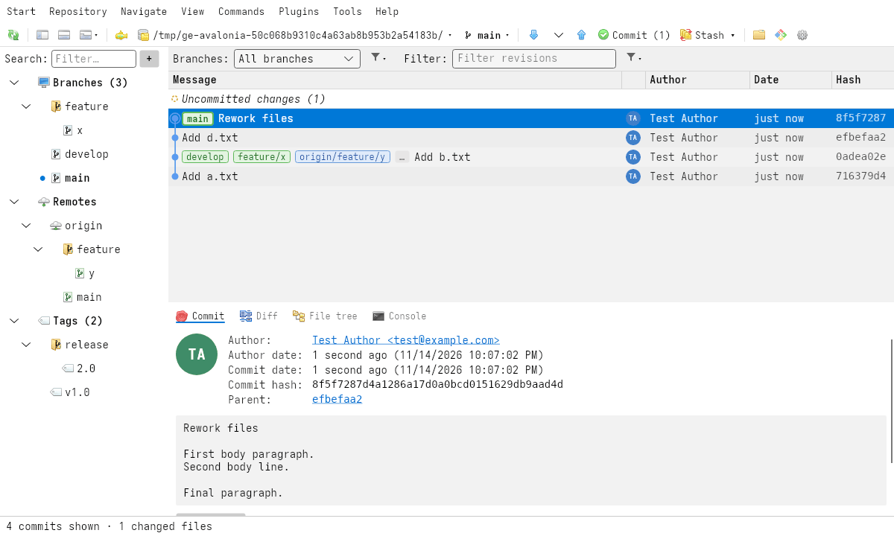

<p align="center">
  
</p>

# Git Extensions for Linux

A native Linux port of [Git Extensions](https://github.com/gitextensions/gitextensions), the graphical Git client.

Git Extensions was written for Windows with WinForms. This project takes the portable core of Git Extensions (`GitCommands`, `GitExtUtils` and the plugin interfaces) and puts a new user interface on top of it, built with [Avalonia](https://avaloniaui.net/), a cross-platform .NET UI framework. The WinForms UI is not used any more, so the application runs natively on Linux, with no Wine and no Mono.

- Website: <https://khunder.github.io/git-extension-linux/>
- Releases: <https://github.com/khunder/git-extension-linux/releases>
- Issues: <https://github.com/khunder/git-extension-linux/issues>



## Features

- Revision grid with commit graph, ref labels, filtering and search
- Commit window with file, hunk and line staging, amend, sign-off, templates and recent messages
- Diff viewer, blame and file history (with rename following)
- Branches, tags, remotes, stashes, submodules and worktrees
- Merge, rebase, cherry-pick, bisect, reset, clean, archive and patches (format, apply, view)
- Merge conflict resolver
- Clone, init, pull and push dialogs; in-window credential prompts through an askpass bridge
- Settings dialog (general, confirmations, colors, git config, SSH, scripts and more)
- Light and dark themes, following the system or chosen manually
- The original Git Extensions icons
- Keyboard shortcuts and a shortcut help dialog
- Command log and reflog browser

## Screenshots

| Commit window | Blame |
| --- | --- |
|  |  |
|  |  |

## Install

Version 0.1.0 packages are attached to the [v0.1.0 release](https://github.com/khunder/git-extension-linux/releases/tag/v0.1.0). All packages are self-contained: no .NET runtime is needed. You need `git` installed.

Download links below use `https://github.com/khunder/git-extension-linux/releases/download/v0.1.0/<file>`. The RPM and Arch file names may carry a distro suffix; check the release page for the exact names.

### Ubuntu / Debian (.deb)

```bash
# amd64
curl -LO https://github.com/khunder/git-extension-linux/releases/download/v0.1.0/git-extensions_0.1.0_amd64.deb
sudo apt install ./git-extensions_0.1.0_amd64.deb

# arm64
curl -LO https://github.com/khunder/git-extension-linux/releases/download/v0.1.0/git-extensions_0.1.0_arm64.deb
sudo apt install ./git-extensions_0.1.0_arm64.deb
```

### Fedora (.rpm)

```bash
curl -LO https://github.com/khunder/git-extension-linux/releases/download/v0.1.0/git-extensions-0.1.0-1.x86_64.rpm
sudo dnf install ./git-extensions-0.1.0-1.x86_64.rpm
```

### openSUSE (.rpm)

```bash
curl -LO https://github.com/khunder/git-extension-linux/releases/download/v0.1.0/git-extensions-0.1.0-1.x86_64.rpm
sudo zypper --no-gpg-checks install ./git-extensions-0.1.0-1.x86_64.rpm
```

The packages are not signed yet, hence `--no-gpg-checks` on openSUSE (on Fedora, `dnf` may need `--nogpgcheck` as well).

### Arch Linux (.pkg.tar.zst)

```bash
curl -LO https://github.com/khunder/git-extension-linux/releases/download/v0.1.0/git-extensions-0.1.0-1-x86_64.pkg.tar.zst
sudo pacman -U ./git-extensions-0.1.0-1-x86_64.pkg.tar.zst
```

### Any distribution (tarball)

```bash
# x64 (use git-extensions-linux-0.1.0-arm64.tar.gz on arm64)
curl -LO https://github.com/khunder/git-extension-linux/releases/download/v0.1.0/git-extensions-linux-0.1.0-x64.tar.gz
tar xzf git-extensions-linux-0.1.0-x64.tar.gz
cd git-extensions
./install.sh              # user-level install under ~/.local, no root needed
./install.sh --uninstall  # remove it again
```

### Verify the download

```bash
curl -LO https://github.com/khunder/git-extension-linux/releases/download/v0.1.0/SHA256SUMS
sha256sum --check --ignore-missing SHA256SUMS
```

### Run

Start "Git Extensions" from the application menu, or from a terminal:

```bash
git-extensions [path/to/repository]
```

## Build from source

Requirements: the [.NET 10 SDK](https://dotnet.microsoft.com/download) and `git`.

```bash
git clone https://github.com/khunder/git-extension-linux.git
cd git-extension-linux
dotnet build GitExtensions.slnx
dotnet run --project src/app/GitExtensions.Avalonia -- <repo path>
```

To build the self-contained tarball (see [packaging/linux/README.md](packaging/linux/README.md)):

```bash
packaging/linux/build-tarball.sh                  # linux-x64
RID=linux-arm64 packaging/linux/build-tarball.sh  # linux-arm64
```

## Tests

```bash
dotnet test GitExtensions.slnx
```

The Avalonia UI tests run headless and use real temporary git repositories. The render tests also write screenshots to `artifacts/Debug/bin/tests/UnitTests/GitExtensions.Avalonia.Tests/net10.0/screenshots/`; those are the images used on the website.

## Repository layout

| Path | Content |
| --- | --- |
| `src/app/GitExtensions.Avalonia` | The Avalonia application (views, view-models, styles, assets) |
| `src/app/GitCommands` | Portable core: running git, parsing output, settings |
| `src/app/GitExtUtils` | Shared utilities |
| `src/app/GitExtensions.Extensibility.Core` | Extensibility types |
| `src/app/GitExtensions.AskPass` | `GIT_ASKPASS` / `SSH_ASKPASS` helper used for credential prompts |
| `src/plugins/GitUIPluginInterfaces` | Plugin interfaces |
| `tests/` | Unit and headless UI tests |
| `packaging/linux` | Tarball builder, installer, desktop entry, icons |
| `site/` | The GitHub Pages website |
| `docs/` | Documentation |

## Known limitations

This is an early release (0.1.0). Not available yet:

- Plugins (the plugin interfaces are kept, but plugins are not loaded or ported)
- Scripts
- Hotkeys editor
- Build server integration
- Several less common settings pages and dialogs from the original application
- Only Linux is targeted; there are no Windows or macOS builds

Bug reports and pull requests are welcome.

## Credits and license

Git Extensions was created by Henk Westhuis and is developed by the [Git Extensions team and contributors](https://github.com/gitextensions/gitextensions/graphs/contributors). This port reuses their GPL-licensed code; all credit for the original application belongs to them. Upstream project: <https://github.com/gitextensions/gitextensions>.

The icons are by [Yusuke Kamiyamane](http://p.yusukekamiyamane.com/), licensed under [CC BY 3.0](http://creativecommons.org/licenses/by/3.0/).

All contributors to Git Extensions formally agree to the certificate of origin in [contributors.txt](contributors.txt).

Licensed under the GNU General Public License v2.0, see [LICENSE.md](LICENSE.md). See also the [code of conduct](CODE_OF_CONDUCT.md) and [contributing guide](CONTRIBUTING.md).
