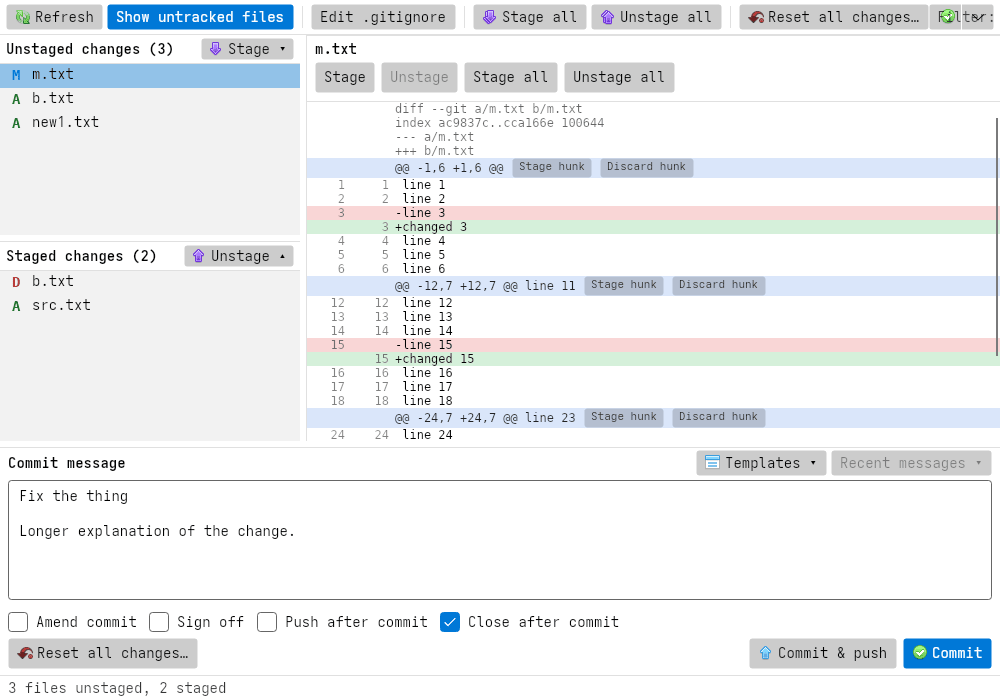
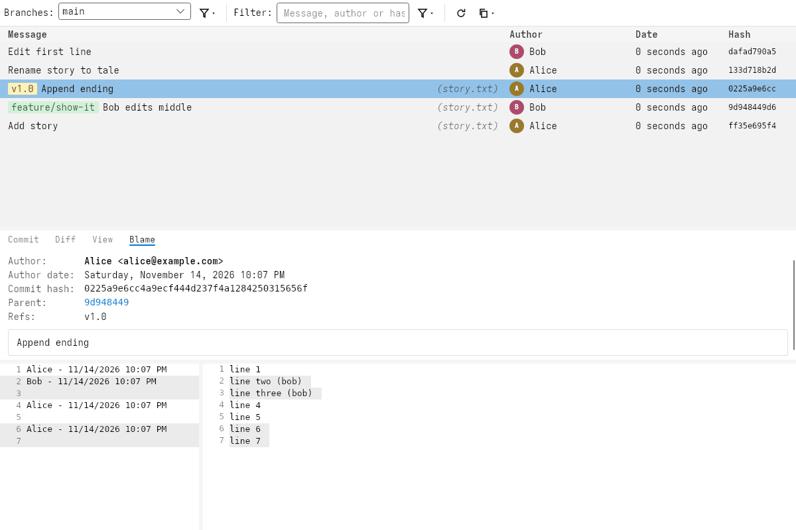
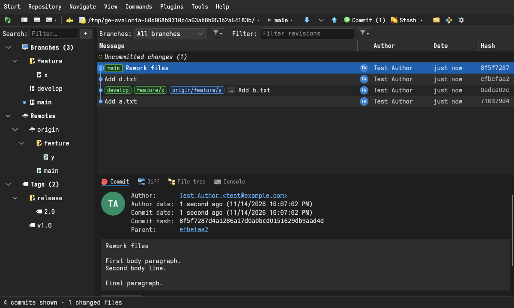
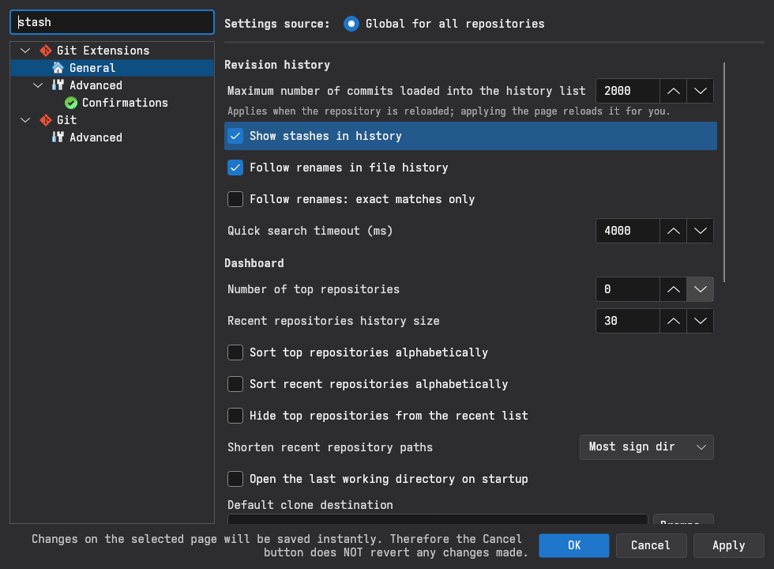

<p align="center">
  
</p>

# Git Extensions Next

[](https://github.com/khunder/git-extension-linux/releases/latest)
[](https://github.com/khunder/git-extension-linux/actions/workflows/ci.yml)
[](LICENSE.md)

A cross-platform (Linux and Windows) port of [Git Extensions](https://github.com/gitextensions/gitextensions), the graphical Git client, with a new native user interface.

Git Extensions was written for Windows with WinForms. This project takes the portable core of Git Extensions (`GitCommands`, `GitExtUtils` and the plugin interfaces) and puts a new user interface on top of it, built with [Avalonia 12](https://avaloniaui.net/), a cross-platform .NET UI framework (running on .NET 11). The WinForms UI is not used any more, so the application runs natively on Linux and Windows, with no Wine and no Mono.

- Website and documentation: <https://khunder.github.io/git-extension-linux/> (docs: <https://khunder.github.io/git-extension-linux/docs/>)
- Releases: <https://github.com/khunder/git-extension-linux/releases>
- Issues: <https://github.com/khunder/git-extension-linux/issues>


## Features

- Revision grid with commit graph, ref labels, filtering and search
- Commit window with file, hunk and line staging, amend, sign-off, templates and recent messages
- Diff viewer, blame and file history (with rename following)
- Branches, tags, remotes, stashes, submodules and worktrees
- Merge, rebase, cherry-pick, bisect, reset, clean, archive and patches (format, apply, view)
- Merge conflict resolver
- Clone, init, pull and push dialogs; in-window credential prompts through an askpass bridge
- Settings dialog (general, confirmations, colors, git config, SSH, scripts and more)
- Light and dark themes, following the system or chosen manually
- The original Git Extensions icons
- Keyboard shortcuts and a shortcut help dialog
- Command log and reflog browser

## Screenshots

| Commit window | Blame |
| --- | --- |
|  |  |
|  |  |

## Install

Download the package for your distribution from the [**latest GitHub release**](https://github.com/khunder/git-extension-linux/releases/latest) (all release assets are built by the [Release workflow](https://github.com/khunder/git-extension-linux/actions/workflows/release.yml)). All packages are self-contained: no .NET runtime is needed, only `git`.

| Distribution | Architecture | Release artifact |
| --- | --- | --- |
| Ubuntu / Debian | amd64 | [`git-extensions_0.2.0_amd64.deb`](https://github.com/khunder/git-extension-linux/releases/download/v0.2.0/git-extensions_0.2.0_amd64.deb) |
| Ubuntu / Debian | arm64 | [`git-extensions_0.2.0_arm64.deb`](https://github.com/khunder/git-extension-linux/releases/download/v0.2.0/git-extensions_0.2.0_arm64.deb) |
| Fedora | x86_64 | [`git-extensions-0.2.0-1.fedora.x86_64.rpm`](https://github.com/khunder/git-extension-linux/releases/download/v0.2.0/git-extensions-0.2.0-1.fedora.x86_64.rpm) |
| Fedora | aarch64 | [`git-extensions-0.2.0-1.fedora.aarch64.rpm`](https://github.com/khunder/git-extension-linux/releases/download/v0.2.0/git-extensions-0.2.0-1.fedora.aarch64.rpm) |
| openSUSE | x86_64 | [`git-extensions-0.2.0-1.opensuse.x86_64.rpm`](https://github.com/khunder/git-extension-linux/releases/download/v0.2.0/git-extensions-0.2.0-1.opensuse.x86_64.rpm) |
| openSUSE | aarch64 | [`git-extensions-0.2.0-1.opensuse.aarch64.rpm`](https://github.com/khunder/git-extension-linux/releases/download/v0.2.0/git-extensions-0.2.0-1.opensuse.aarch64.rpm) |
| Arch Linux | x86_64 | [`git-extensions-0.2.0-1-x86_64.pkg.tar.zst`](https://github.com/khunder/git-extension-linux/releases/download/v0.2.0/git-extensions-0.2.0-1-x86_64.pkg.tar.zst) |
| Any distribution (tarball) | x64 | [`git-extensions-linux-0.2.0-x64.tar.gz`](https://github.com/khunder/git-extension-linux/releases/download/v0.2.0/git-extensions-linux-0.2.0-x64.tar.gz) |
| Any distribution (tarball) | arm64 | [`git-extensions-linux-0.2.0-arm64.tar.gz`](https://github.com/khunder/git-extension-linux/releases/download/v0.2.0/git-extensions-linux-0.2.0-arm64.tar.gz) |
| AppImage (any distribution) | x86_64 | [`git-extensions-0.2.0-x86_64.AppImage`](https://github.com/khunder/git-extension-linux/releases/download/v0.2.0/git-extensions-0.2.0-x86_64.AppImage) |
| AppImage (any distribution) | aarch64 | [`git-extensions-0.2.0-aarch64.AppImage`](https://github.com/khunder/git-extension-linux/releases/download/v0.2.0/git-extensions-0.2.0-aarch64.AppImage) |
| Checksums | all | [`SHA256SUMS`](https://github.com/khunder/git-extension-linux/releases/download/v0.2.0/SHA256SUMS) |

With the GitHub CLI you can also fetch an artifact directly: `gh release download v0.2.0 --repo khunder/git-extension-linux --pattern '*.deb'`.

### Ubuntu / Debian (.deb)

```bash
# amd64
curl -LO https://github.com/khunder/git-extension-linux/releases/download/v0.2.0/git-extensions_0.2.0_amd64.deb
sudo apt install ./git-extensions_0.2.0_amd64.deb

# arm64
curl -LO https://github.com/khunder/git-extension-linux/releases/download/v0.2.0/git-extensions_0.2.0_arm64.deb
sudo apt install ./git-extensions_0.2.0_arm64.deb
```

### Fedora (.rpm)

```bash
curl -LO https://github.com/khunder/git-extension-linux/releases/download/v0.2.0/git-extensions-0.2.0-1.fedora.x86_64.rpm
sudo dnf install ./git-extensions-0.2.0-1.fedora.x86_64.rpm
```

### openSUSE (.rpm)

```bash
curl -LO https://github.com/khunder/git-extension-linux/releases/download/v0.2.0/git-extensions-0.2.0-1.opensuse.x86_64.rpm
sudo zypper --no-gpg-checks install ./git-extensions-0.2.0-1.opensuse.x86_64.rpm
```

The packages are not signed yet, hence `--no-gpg-checks` on openSUSE (on Fedora, `dnf` may need `--nogpgcheck` as well).

### Arch Linux (.pkg.tar.zst)

```bash
curl -LO https://github.com/khunder/git-extension-linux/releases/download/v0.2.0/git-extensions-0.2.0-1-x86_64.pkg.tar.zst
sudo pacman -U ./git-extensions-0.2.0-1-x86_64.pkg.tar.zst
```

### Any distribution (tarball)

```bash
# x64 (use git-extensions-linux-0.2.0-arm64.tar.gz on arm64)
curl -LO https://github.com/khunder/git-extension-linux/releases/download/v0.2.0/git-extensions-linux-0.2.0-x64.tar.gz
tar xzf git-extensions-linux-0.2.0-x64.tar.gz
cd git-extensions
./install.sh              # user-level install under ~/.local, no root needed
./install.sh --uninstall  # remove it again
```

### AppImage (any distribution, no installation)

```bash
curl -LO https://github.com/khunder/git-extension-linux/releases/download/v0.2.0/git-extensions-0.2.0-x86_64.AppImage
chmod +x git-extensions-0.2.0-x86_64.AppImage
./git-extensions-0.2.0-x86_64.AppImage [path-to-repository]
```

The AppImage bundles the application and the .NET runtime; it uses the system's X11, fontconfig and OpenSSL 3 libraries and needs `git` installed. On systems without FUSE 2 run it with `--appimage-extract-and-run`.

### Verify the download

```bash
curl -LO https://github.com/khunder/git-extension-linux/releases/download/v0.2.0/SHA256SUMS
sha256sum --check --ignore-missing SHA256SUMS
```

### Windows

Windows 10 and 11 (x64 and arm64) are supported as a secondary platform. [Git for Windows](https://git-scm.com/download/win) must be installed. Both downloads are self-contained (no .NET runtime needed):

- `git-extensions-<version>-windows-x64-setup.exe` (or `-arm64-`): installer (per user by default, no admin rights needed)
- `git-extensions-windows-<version>-x64.zip` (or `-arm64`): portable, unzip anywhere and run `GitExtensions.Avalonia.exe`

### Run

Start "Git Extensions Next" from the application menu, or from a terminal:

```bash
git-extensions [path/to/repository]
```

## Build from source

Requirements: the [.NET 11 SDK](https://dotnet.microsoft.com/download) and `git`.

```bash
git clone https://github.com/khunder/git-extension-linux.git
cd git-extension-linux
dotnet build GitExtensions.slnx
dotnet run --project src/app/GitExtensions.Avalonia -- <repo path>
```

To build the self-contained tarball (see [packaging/linux/README.md](packaging/linux/README.md)):

```bash
packaging/linux/build-tarball.sh                  # linux-x64
RID=linux-arm64 packaging/linux/build-tarball.sh  # linux-arm64
```

To build the Windows zip and installer (needs PowerShell 7; the installer also needs [Inno Setup 6](https://jrsoftware.org/isinfo.php)):

```powershell
pwsh packaging/windows/build.ps1 -Arch x64    # or arm64; add -SkipInstaller for the zip only
```

## Tests

```bash
dotnet test GitExtensions.slnx
```

The Avalonia UI tests run headless and use real temporary git repositories. The render tests also write screenshots to `artifacts/Debug/bin/tests/UnitTests/GitExtensions.Avalonia.Tests/net11.0/screenshots/`; those are the images used on the website.

## Repository layout

| Path | Content |
| --- | --- |
| `src/app/GitExtensions.Avalonia` | The Avalonia application (views, view-models, styles, assets) |
| `src/app/GitCommands` | Portable core: running git, parsing output, settings |
| `src/app/GitExtUtils` | Shared utilities |
| `src/app/GitExtensions.Extensibility.Core` | Extensibility types |
| `src/app/GitExtensions.AskPass` | `GIT_ASKPASS` / `SSH_ASKPASS` helper used for credential prompts |
| `src/plugins/GitUIPluginInterfaces` | Plugin interfaces |
| `tests/` | Unit and headless UI tests |
| `packaging/linux` | Tarball builder, installer, desktop entry, icons |
| `site/` | The GitHub Pages website |
| `docs/` | Documentation |

## Known limitations

This is an early release (0.2.0). Not available yet:

- Plugins (the plugin interfaces are kept, but plugins are not loaded or ported)
- Scripts
- Hotkeys editor
- Build server integration
- Several less common settings pages and dialogs from the original application
- Linux is the primary target. Windows builds are new and less tested; there are no macOS builds

Bug reports and pull requests are welcome.

## Credits and license

Git Extensions was created by Henk Westhuis and is developed by the [Git Extensions team and contributors](https://github.com/gitextensions/gitextensions/graphs/contributors). This port reuses their GPL-licensed code; all credit for the original application belongs to them. Upstream project: <https://github.com/gitextensions/gitextensions>.

The icons are by [Yusuke Kamiyamane](http://p.yusukekamiyamane.com/), licensed under [CC BY 3.0](http://creativecommons.org/licenses/by/3.0/).

All contributors to Git Extensions formally agree to the certificate of origin in [contributors.txt](contributors.txt).

Licensed under the GNU General Public License v3.0, see [LICENSE.md](LICENSE.md). See also the [code of conduct](CODE_OF_CONDUCT.md) and [contributing guide](CONTRIBUTING.md).
